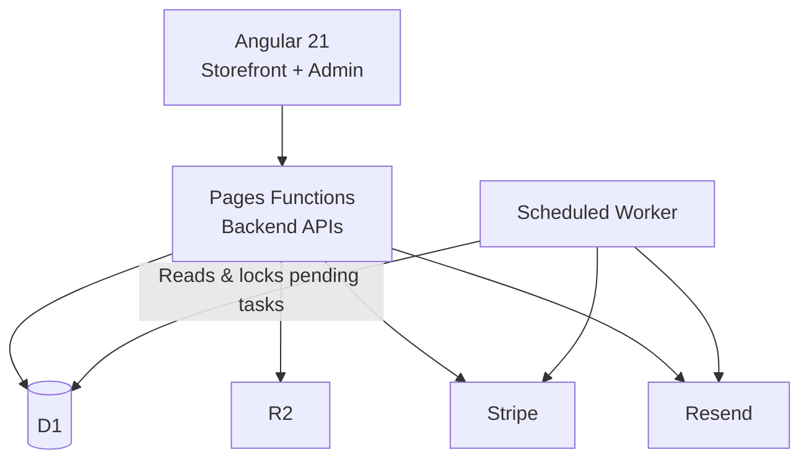
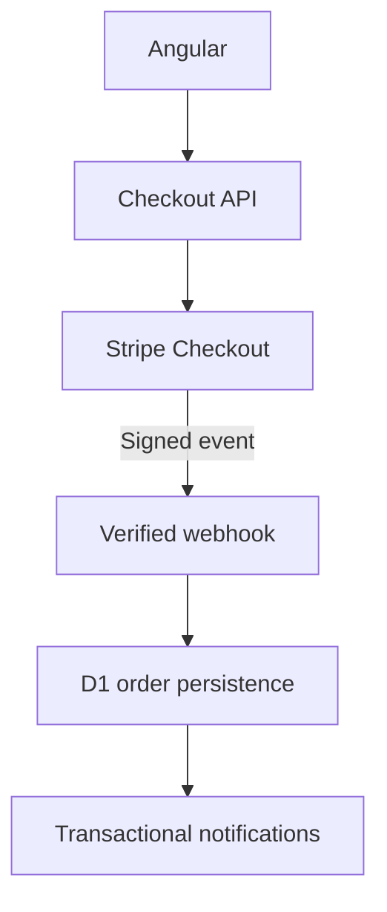
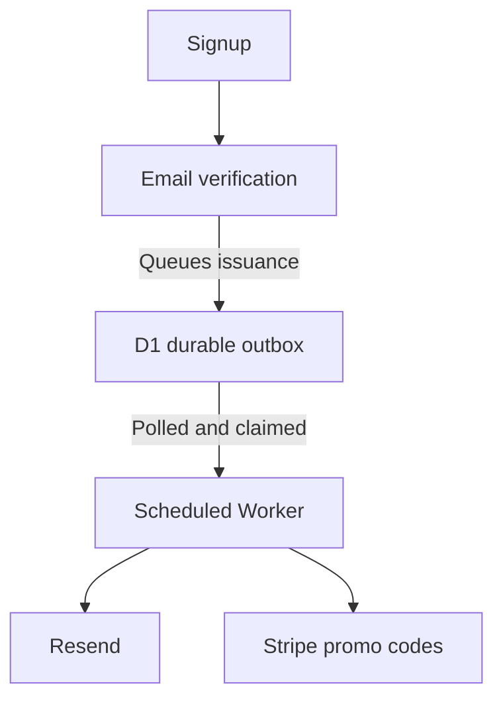

# Architecture

NAIS Drinks is a full-stack e-commerce application built with Angular, TypeScript and Cloudflare, integrating Stripe for payments and promotional codes, and Resend for email delivery.

The architecture separates the frontend, backend APIs, data storage and asynchronous processing. The diagrams illustrate application responsibilities and data flows rather than operational configuration.

## High-Level Architecture

### Main Components

- **Angular 21:** Storefront, catalogue, cart and administration interface, using TypeScript, Signals, RxJS, lazy-loaded routes and Catalan/Spanish localization.
- **Cloudflare Pages Functions:** Backend APIs responsible for validation, Checkout, verified webhooks, administrative authorization and order management.
- **Cloudflare D1 (SQLite):** Product catalogue, order records, promotional data and persistent background jobs.
- **Cloudflare R2:** Product image storage.
- **Stripe:** Hosted Checkout, payment processing, catalogue synchronization and promotional codes.
- **Resend:** Transactional emails and newsletter delivery.
- **Cloudflare Workers:** Scheduled processing of newsletter and promotional jobs stored in D1.

## Why This Stack?

The technologies used in NAIS provide a practical architecture for a small e-commerce application without maintaining a dedicated traditional server.

**Angular and TypeScript** provide a structured frontend, reusable components and typed application contracts. Signals support reactive state management, including shopping-cart interactions.

**Cloudflare** combines frontend hosting, serverless APIs, SQLite-based storage, object storage and scheduled background processing within one ecosystem.

**Stripe Checkout** handles the payment interface and payment processing, reducing the need to develop and maintain a custom payment flow.

**Resend** provides an external email service for order confirmations, notifications and newsletter communications.

These are practical benefits of the architecture, not claims that this stack is the best choice for every application.

## Checkout Flow

The Checkout API validates product availability and determines authoritative prices on the server before creating a Stripe Checkout Session.

After payment, Stripe sends a signed webhook. The backend verifies the signature and payment status before persisting the order and its purchased-product snapshots in D1.

The browser redirect to the confirmation page is not considered proof of payment.

Customer order confirmations and internal notifications are sent through Resend. Shipping notifications follow a separate path triggered by an authorized fulfillment update; they are not processed by the scheduled newsletter Worker.

## Newsletter and Promotions Flow

Newsletter subscriptions and promotional-code issuance involve several asynchronous operations.

The initial signup queues a verification email through D1 and the scheduled Worker. Once the email address is verified, the application queues promotional-code issuance.

The Worker processes eligible jobs, interacts with Stripe to issue promotional codes and queues a separate email job to communicate the resulting code through Resend.

This approach separates user-facing requests from background processing and supports controlled retries and recovery when external services fail.

D1 stores pending jobs, but does not automatically trigger Workers. Scheduled executions retrieve and claim eligible work. Other newsletter-related operations, including confirmation and optional contact synchronization, also use persistent jobs.

## Security and Reliability

**Server-side validation:** The backend validates product availability, prices, payment status and administrative permissions. Angular guards manage frontend navigation but do not replace server-side authorization.

**Payment verification:** Signed Stripe webhooks are verified before orders are confirmed. Browser-side state and redirects are not trusted as payment evidence.

**Asynchronous processing:** Background jobs use atomic claims, ownership leases, bounded retries and idempotency mechanisms to reduce duplicate processing.

**External-service consistency:** D1, Stripe and Resend operate independently and do not share a database transaction. The application therefore handles partial failures through persisted state and reconciliation.

These mechanisms improve reliability but do not guarantee that every external operation executes exactly once. Similarly, acceptance by an email provider does not prove delivery to the recipient's inbox.

Further technical examples and implementation trade-offs are documented in [Engineering Decisions](engineering-decisions.md).
