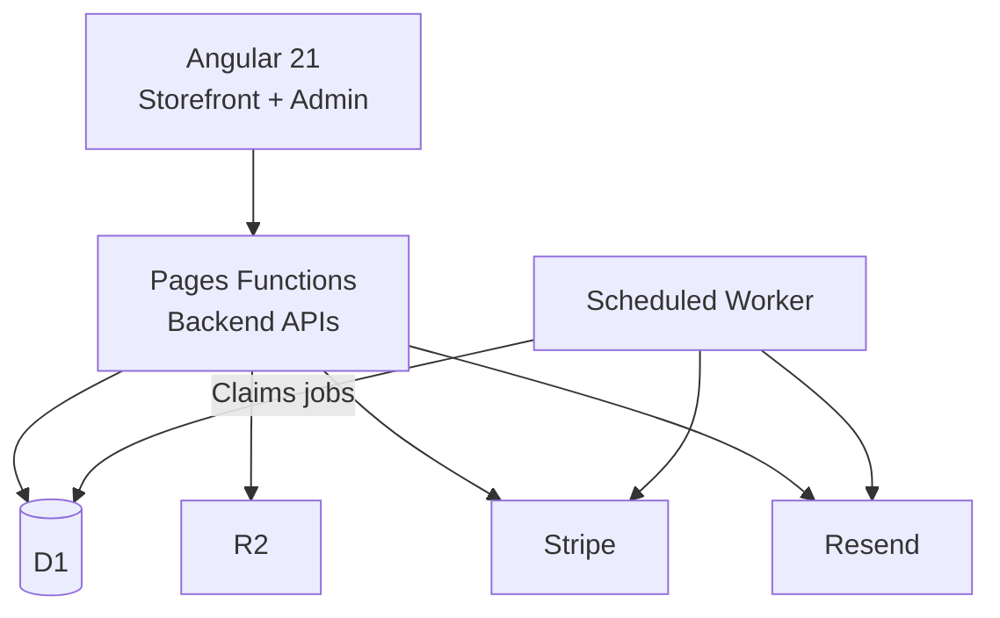
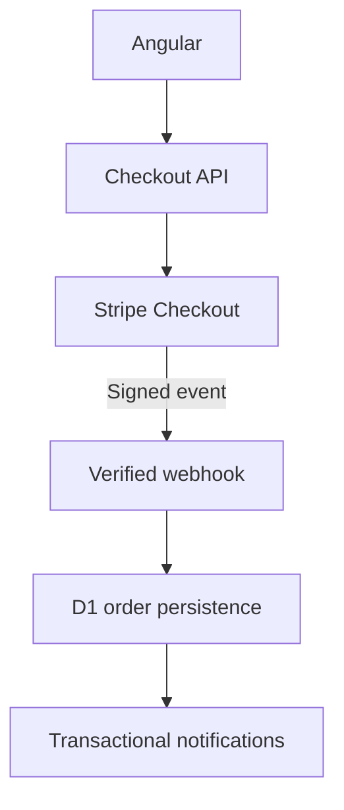
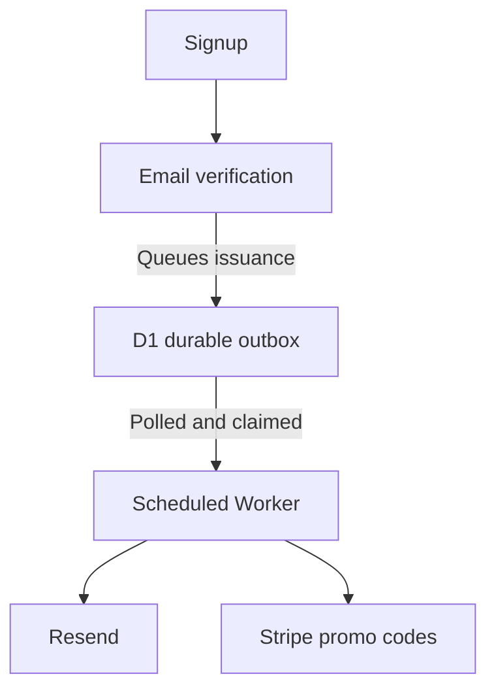

# Architecture

NAIS uses client-side Angular rendering with a Cloudflare backend, Stripe for payments and promotional codes, and Resend for email submission. These diagrams show responsibilities and application flows, not operational configuration.

## High-Level Architecture

- **Angular:** standalone components, lazy-loaded routes, service-owned state, signals and RxJS; reactive Catalan/Spanish presentation.
- **Pages Functions:** validation, server-side Admin authorization, Checkout, webhooks and fulfillment operations.
- **D1:** catalogue, order snapshots, consent records and durable jobs. **R2:** uploaded product images.
- **Stripe:** hosted payments, catalogue synchronization and restricted promotional-code issuance. **Resend:** email submission.
- **Scheduled Worker:** claims eligible D1 jobs for newsletter and promotional processing, subject to feature flags. D1 does not trigger the Worker.

## Checkout Flow

The Checkout API resolves catalogue prices and availability on the server. Webhook processing verifies the signature and payment before persisting the order and its items; it then invokes customer confirmation and internal notification through Resend. The browser redirect does not establish payment success.

Shipping email is a separate transactional path: an authorized fulfillment update from preparing to shipped invokes its email service. These order emails are not processed by the scheduled newsletter Worker.

## Newsletter and Promotions Flow

This diagram summarizes the newsletter-first promotion. Signup first queues the verification email through the same D1/Worker delivery mechanism. Successful email verification queues code issuance; successful Stripe issuance queues a separate code-email job for Resend. The two provider branches are separate processing responsibilities, not simultaneous steps or a payment flow.

General newsletter confirmation and optional contact synchronization also use durable jobs. A scheduled invocation drives processing; the outbox arrow represents the Worker's read/claim, not a database push.

## Boundaries and Trade-Offs

Admin authorization is enforced on the server; Angular guards only control navigation. Browser storage correlates a cart with a purchase attempt and is not proof of payment.

D1, Stripe and Resend do not share a transaction. Atomic job claims, ownership leases, bounded retries, provider idempotency and reconciliation address partial failures without promising exactly-once delivery. Provider acceptance of email does not prove inbox delivery.
